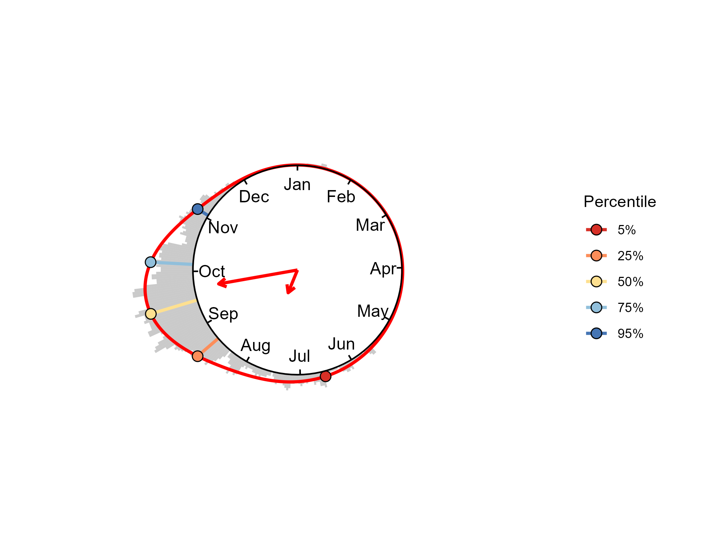

# Tropical cyclone seasonality: von Mises mixture fit of a TCday sample

> Treppiedi, D., Villarini, G., Scoccimarro, E., Yang, W., Vecchi, G. A., and Noto, L. V.
> *Contrasting Shifts in Tropical Cyclone Seasonality Across Global Basins.*
> Geophysical Research Letters.

The script takes one sample of TCday (one basin, one intensity class, one time
window), describes the position of those days inside the year with a mixture of
von Mises distributions, and extracts the percentiles of the fitted
distribution, which are the seasonality metrics used in the paper (TCnth).



## What a TCday is

Every day of the year during which a storm was active counts as one TCday, with
the maximum intensity reached on that day.
The example file is already prepared in this way, starting
from [IBTrACS v4](https://www.ncei.noaa.gov/products/international-best-track-archive).


## Files

| File | Description |
| --- | --- |
| `Fit_vonMises_TCday.R` | the script |
| `TCdays_NorthAtlantic_2010_2024.csv` | example input: 1,662 TCday, North Atlantic, 2010–2024 |
| `Percentiles.csv` | example output: the five percentiles |
| `Seasonality.png` | example output: the figure above |

## How to run it

Requires R (>= 4.0) and the packages `movMF`, `ggplot2` and `stringr`:

```r
install.packages(c("movMF", "ggplot2", "stringr"))
```

Put the script and the csv file in the same folder, open the script in RStudio and 
set that folder as the working directory. It writes
`Percentiles.csv` and `Seasonality.png` in the same folder.

## Input format

One row per TCday. Only the column `Date` (format `YYYY-MM-DD`) is used; the
other columns are there to describe the sample.

```
Date,Basin,Category,MaxWind_ms
2010-06-26,North Atlantic,Tropical Storm,28.3
2010-06-27,North Atlantic,Tropical Storm,28.3
```

## Output

`Percentiles.csv` gives each percentile as a date and as the day of the season:

| Percentile | Date | Day_of_season |
| --- | --- | --- |
| 5% | 17 Jun | 108.4 |
| 25% | 21 Aug | 173.4 |
| 50% | 15 Sep | 197.9 |
| 75% | 05 Oct | 217.8 |
| 95% | 03 Nov | 246.6 |

In the paper these percentiles are computed on 15-year rolling windows and their
trends are tested with a permutation of the year labels of the daily record.
